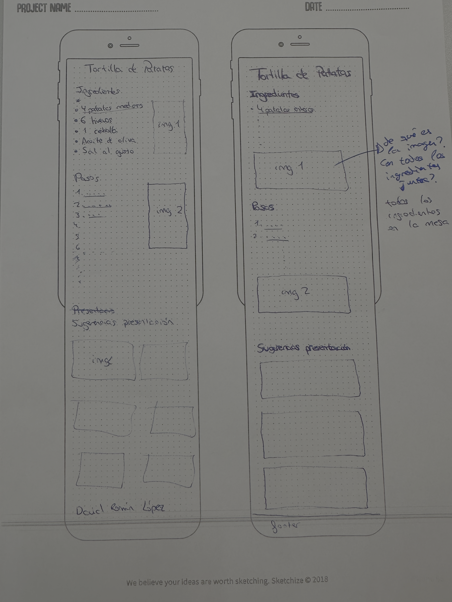

# Reflexión sobre el Prototipado

**Autor:** David Román López  
**Proyecto:** Maquetación de la Receta (Tortilla de Patatas)

---

## 1. Boceto del Prototipo en Papel

---

## 2. Conclusiones y Valoración

* **Comodidad y agilidad:**  
  Para un prototipo rápido y básico sí me he sentido más cómodo realizándolo en papel; no obstante, para un trabajo más completo sigo prefiriendo diseñar directamente en el ordenador.

* **Feedback y correcciones:**  
  Lo considero medianamente útil para recibir correcciones rápidas y puntuales por parte de otras personas antes de picar código.

* **Presentación del prototipo:**  
  En general suelo preferir presentar algo un poco más elaborado en ordenador como prototipo, por lo que no me decanto por el papel para mostrar el resultado final.

* **Percepción del proceso:**  
  Sigo teniendo la misma percepción que tenía antes sobre las ventajas e inconvenientes del prototipado físico frente al digital.
